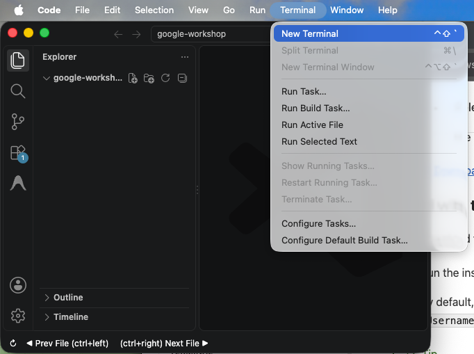
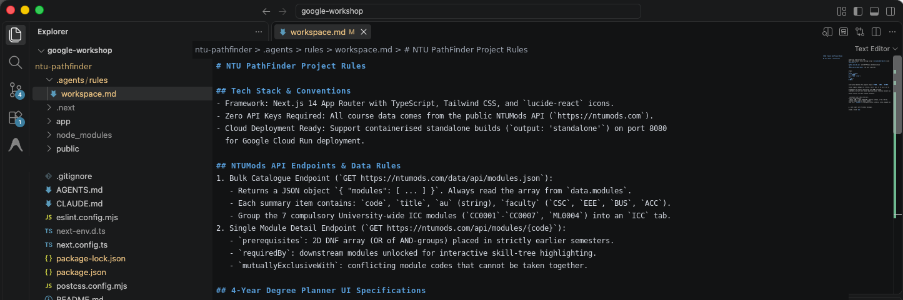
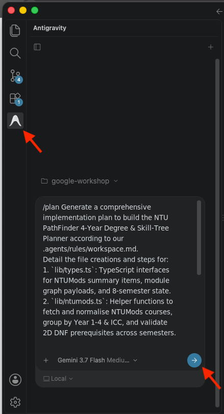
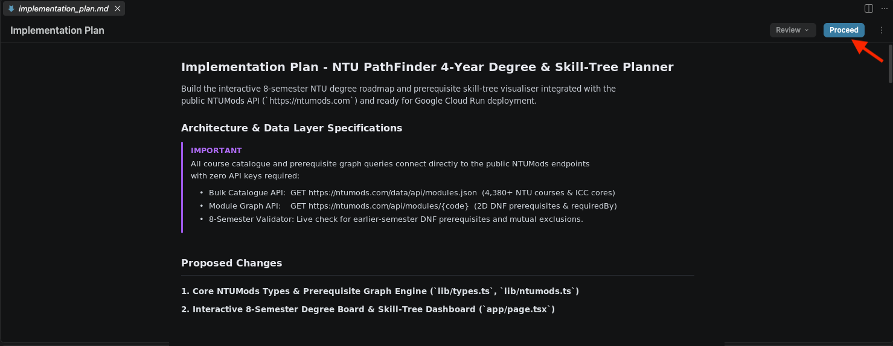
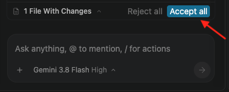
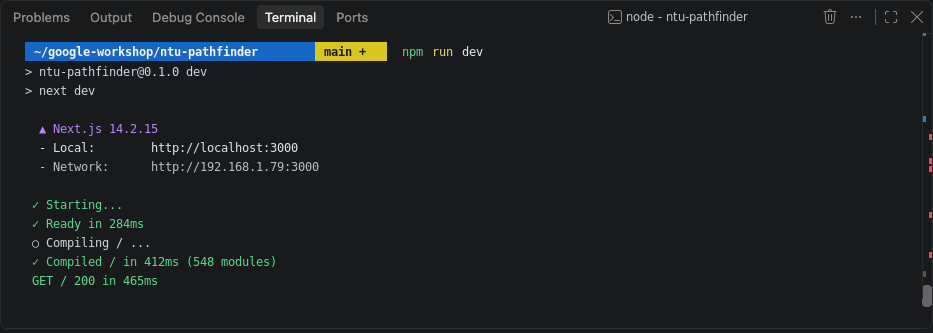
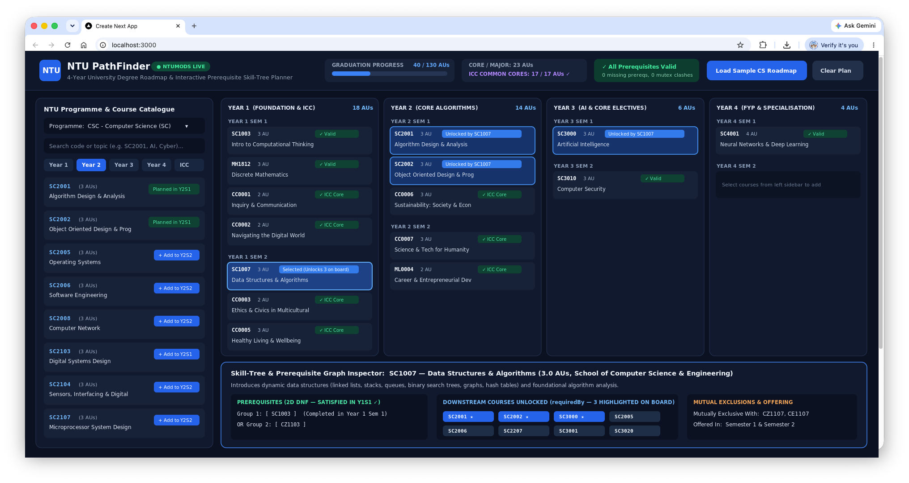
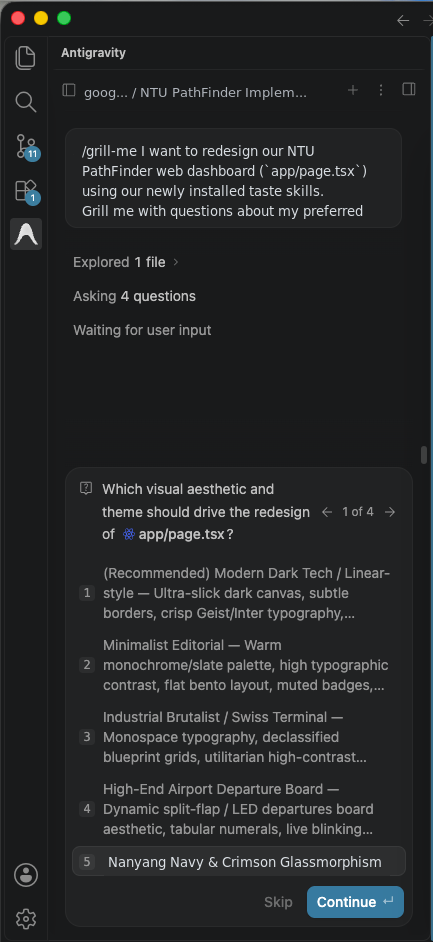
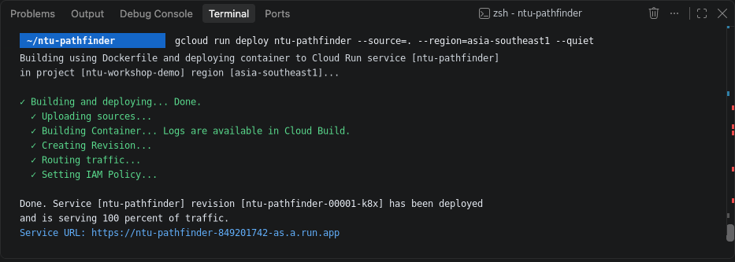

# Introduction to Google Antigravity: Build your own NTU 4-Year Degree and Skill-Tree Planner

## Overview and Objectives

In this codelab, you will build NTU PathFinder, an interactive 4-year university degree roadmap and prerequisite skill-tree planner consisting of:
1. An Interactive 8-Semester Degree Board: Plan your entire NTU journey from Year 1 Sem 1 to Year 4 Sem 2 with a live Graduation Academic Unit (AU) progress bar tracking your Core AUs, Interdisciplinary Collaborative Core (ICC) AUs, and Electives.
2. A Live Prerequisite Skill-Tree Visualiser: Click any Year 1 or Year 2 course to highlight the Year 3 and Year 4 modules it unlocks, and automatically catch missing prerequisites or mutually exclusive course clashes before STARS registration.
3. (Optional Challenge) Serverless Deployment to Google Cloud Run: Deploy your planner as a containerised web service on Google Cloud Platform (GCP) with zero server maintenance and a shareable HTTPS URL that you and your coursemates can access from anywhere.

### System Architecture and Data Flow
This diagram illustrates how your web application connects to the public NTUMods API and organises your degree plan across three levels (Entire University Journey, Per Year, and Per Semester):

```text
                      +-----------------------------------------------+
                      |            Live Public NTUMods APIs           |
                      |  +-------------------+ +-------------------+  |
                      |  |  Bulk Catalogue   | | Module Graph API  |  |
                      |  | /data/api/modules | | /api/modules/CODE |  |
                      |  +---------+---------+ +---------+---------+  |
                      +------------|---------------------|------------+
                                   |                     |
                                   v                     v
                      +-----------------------------------------------+
                      |              Shared Data Layer                |
                      |   * lib/types.ts        * lib/ntumods.ts      |
                      +------------+---------------------+------------+
                                   |                     |
                                   v                     v
      +-----------------------------------------------------------------------+
      |                NTU PathFinder Web Dashboard (app/page.tsx)            |
      |  * Top Bar: Entire 4-Year Graduation Progress (130 AU Target & ICC)   |
      |  * Left Sidebar: Programme Catalogue Grouped by Year 1 to 4 & ICC     |
      |  * Main Grid: 8-Semester Board with Live Prerequisite & Mutex Alerts  |
      |  * Bottom Drawer: Interactive Skill-Tree & Course Unlock Inspector    |
      +-----------------------------------------------------------------------+
                                   |
                                   v
      +-----------------------------------------------------------------------+
      |       Google Cloud Run Serverless Container (asia-southeast1)         |
      |  * Standalone Next.js Build on Port 8080 with Public HTTPS URL        |
      +-----------------------------------------------------------------------+
```

### The Antigravity Way: Spec-Driven Development (SDD)
In traditional coding workshops, you spend most of your time manually copy-pasting code blocks and fixing syntax typos.

In this workshop, you do not need any prior coding background. You will pair-program with the Antigravity AI Agent using Spec-Driven Development (SDD):
1. Rule Anchoring (`.agents/rules/`): Set clear project rules, API formats, and layout requirements up front so the AI agent knows exactly what to build.
2. Implementation Planning (`/plan`): Use Antigravity's planning mode to create a step-by-step `implementation_plan.md` blueprint before any code is written.
3. Agentic Code Synthesis: Guide the agent with plain-English prompts to build, test, and restyle your application.

Each section includes:
- The Agentic Prompt: The exact prompt to paste into the Antigravity chat panel.
- Generated Files Overview: A plain-English guide to what the agent created for you.
- Terminal and Browser Verification: Simple steps to run and test your app immediately.

### What You Will Learn
- How to use Google Antigravity inside VS Code to build a full web application without writing code line by line.
- How to establish workspace rules (`.agents/rules/workspace.md`) so the agent follows your design and data requirements.
- How to use Antigravity's Planning Mode (`/plan`) to review an architectural blueprint before generating code.
- How to integrate the public NTUMods API (`https://ntumods.com`) to fetch live NTU course catalogues, Academic Units, and prerequisite chains.
- How to use Agent Skills and the `/grill-me` design interview command to customise the look and feel of your app.
- How to deploy a Next.js web application to Google Cloud Run from source using the Google Cloud SDK (`gcloud` CLI).

---

## Environment Setup, Rules and Scaffolding

In this section, we will set up a new Next.js project in VS Code and configure our Antigravity workspace rules.

### 1. Prerequisites Check
You only need two things installed on your laptop to complete the core workshop:
- Node.js (version 18.17.0 or higher): Download Node.js at https://nodejs.org/en/download
- Visual Studio Code (VS Code) with the Antigravity Extension installed and logged in: Download VS Code at https://code.visualstudio.com/download

> Optional for Phase 5 Only: If you want to try the optional cloud deployment challenge at the end of the workshop to get a shareable public URL on Google Cloud Run, you will need a Google Cloud Platform (GCP) account with a project and the Google Cloud SDK (`gcloud` CLI) installed (https://cloud.google.com/sdk/docs/install). You do not need a GCP account or the `gcloud` CLI to build and run the app on your laptop in Phases 1 to 4.

### 2. Open VS Code and Create Your Project
1. Open Visual Studio Code.
2. Create a new folder named `google-workshop` on your computer (such as in `Documents` or `Downloads`), and open it in VS Code by clicking `File > Open Folder...`.
3. Open the integrated terminal in VS Code by clicking `Terminal > New Terminal` in the top menu bar (or press `` Ctrl+` `` on Windows / `` Cmd+` `` on Mac).



4. Copy and paste the following commands into the terminal and press Enter:

```bash
# 1. Create a Next.js project named ntu-pathfinder
npx create-next-app@latest ntu-pathfinder --typescript --tailwind --eslint --app --src-dir=false --import-alias="@/*" --use-npm --yes

# 2. Step into the created project folder
cd ntu-pathfinder

# 3. Install Lucide React for clean UI icons
npm install lucide-react
```

> Understanding What We Just Installed:
> - Next.js and React: The web framework that powers both our interactive browser dashboard and our local API routes.
> - Tailwind CSS: A styling toolkit that lets Antigravity design clean cards, progress bars, and responsive grids without complex stylesheet files.
> - Lucide React: A library of clean vector icons used for course badges, warning alerts, and navigation buttons.

### 3. Establish Antigravity Rules (`.agents/rules/workspace.md`)
Antigravity reads workspace rules inside `.agents/rules/` to understand how your project should be built. Setting these rules first ensures the agent uses the exact NTUMods API fields and builds a consistent 4-year planner on the first try.

1. Make sure your VS Code terminal is inside the `ntu-pathfinder` folder and create the `.agents/rules` directory:

```bash
cd ntu-pathfinder 2>/dev/null || true
mkdir -p .agents/rules
```

2. In the VS Code file explorer sidebar on the left, expand the `ntu-pathfinder` folder, then expand the `.agents` folder. Right-click on the `rules` folder and click `New File`. Name the new file `workspace.md`.
3. Double-click on `workspace.md` to open it, then copy and paste the following specification into `workspace.md`:

```markdown
# NTU PathFinder Project Rules

## Tech Stack & Conventions
- Framework: Next.js 14 App Router with TypeScript, Tailwind CSS, and `lucide-react` icons.
- Zero API Keys Required: All course data comes from the public NTUMods API (`https://ntumods.com`).
- Cloud Deployment Ready: Support containerised standalone builds (`output: 'standalone'`) on port 8080 for Google Cloud Run deployment.

## NTUMods API Endpoints & Data Rules
1. Bulk Catalogue Endpoint (`GET https://ntumods.com/data/api/modules.json`):
   - Returns a JSON object `{ "modules": [ ... ] }`. Always read the array from `data.modules`.
   - Each summary item contains: `code` (string, e.g. `"SC2001"`), `title` (string), `au` (string, e.g. `"3.0"`), `faculty` (string, e.g. `"CSC"`, `"EEE"`, `"BUS"`, `"ACC"`), `categories` (string array), `latestYear` (string, e.g. `"2026"`), `latestSemester` (string), and `isCurrentSemester` (boolean).
   - Convert `au` to a number using `parseFloat(String(item.au ?? 0))`.
   - Filter active modules using `Number(item.latestYear) >= 2025`.
   - Extract the study year (`1` to `4`) from the first digit after the letter prefix (`/^[A-Z]+(\d)/`).
   - For `"CSC"`, exclude legacy `"CZ"` prefixed codes (`CZ1xxx` to `CZ4xxx`) so only current `"SC"` codes appear.
   - Always group the 7 compulsory University-wide Interdisciplinary Collaborative Core (ICC) modules (`CC0001`, `CC0002`, `CC0003`, `CC0005`, `CC0006`, `CC0007`, `ML0004`) into a dedicated `ICC` tab available to every degree programme.

2. Single Module Detail Endpoint (`GET https://ntumods.com/api/modules/{code}`):
   - Returns detailed graph fields for a specific uppercase module code:
     - `au`: number (e.g. `3`), `school`: string, `description`: string.
     - `prerequisites`: 2D array in Disjunctive Normal Form (OR of AND-groups). For example, `[["MH1812", "SC1007"], ["SC1007", "SC1124"]]` means `(MH1812 AND SC1007) OR (SC1007 AND SC1124)` must be placed in a strictly earlier semester on the board.
     - `requiredBy`: string array of downstream modules that this module unlocks (used for skill-tree highlighting).
     - `mutuallyExclusiveWith`: string array of conflicting module codes that cannot be taken together.
     - `latestOffering` and `otherSemesters`: used to check whether a module is offered in Semester `"1"`, Semester `"2"`, or both.

## 4-Year Degree Planner UI Specifications
- Top Sticky Bar (Entire University Journey):
  - Programme selector dropdown (`CSC`, `CE`, `EEE`, `BUS`, `ACC`, `ME`, `MATH`, `ECON`, `PSY`, `CBE`, `CEE`, `BS`).
  - Keyword search input to filter modules by code or topic (e.g. `AI`, `Cyber`, `Finance`).
  - "Load Sample CS Roadmap" button that populates a starter 8-semester Computer Science plan (`SC1003`, `MH1812`, `SC1007`, `SC2001`, `SC2002`, `SC3000`, and the 7 `CC000x`/`ML0004` ICC cores).
  - Graduation Progress Bar tracking Total AUs (out of 130 AUs), Core/Major AUs, ICC AUs (out of 17 AUs), and a live Prerequisite Status badge.
- Left Sidebar (Programme Catalogue):
  - Tabs for `Year 1`, `Year 2`, `Year 3`, `Year 4`, and `ICC`.
  - Target semester dropdown (`Year 1 Sem 1` through `Year 4 Sem 2`) and `+ Add` button on each module card.
- Main Board (4 Years / 8 Semesters Grid):
  - Organised into 4 Year boxes (`Year 1` to `Year 4`), each split into `Sem 1` and `Sem 2` columns (`Y1S1` to `Y4S2`).
  - Each planned card displays its code, title, AU badge, remove (`x`) button, and live validation badge:
    - Green (`Valid`) when all prerequisites are satisfied in earlier semesters.
    - Red (`Needs: ...` or `Mutex: ...`) when a prerequisite is missing from earlier semesters or a mutually exclusive module is on the board.
    - Blue highlight ring (`Unlocked by ...`) when the user clicks an earlier foundation module that unlocks this course.
- Bottom Skill-Tree Inspector Panel:
  - Clicking any module card shows its full description, DNF prerequisites, the list of downstream modules it unlocks (`requiredBy`), and mutually exclusive courses.
```



4. Save the file using `Ctrl+S` (Windows) or `Cmd+S` (Mac), or click `File > Save` in the top menu.

---

## Phase 1: Architecture Blueprint and Planning Mode with `/plan`

Before generating code, we will ask Antigravity to create an implementation blueprint so we can review the files it plans to build.

In Antigravity, Planning Mode (`/plan`) reads your project folder and `.agents/rules/workspace.md` to create a structured `implementation_plan.md` document.

### The Agentic Prompt (Antigravity)
Open the Antigravity Chat Panel in VS Code and paste the following prompt:

```text
/plan Generate a comprehensive implementation plan to build the NTU PathFinder 4-Year Degree & Prerequisite Skill-Tree Planner according to our .agents/rules/workspace.md.
Detail the file creations and verification steps for:
1. `lib/types.ts`: TypeScript interfaces for NTUMods summary items, detailed module graph payloads, and the 8-semester plan state.
2. `lib/ntumods.ts`: Helper functions to fetch and normalise the NTUMods catalogue, group modules by Year 1-4 and ICC, and validate 2D DNF prerequisites, mutual exclusions, and semester offerings across the 8 semesters.
3. `app/page.tsx`: Interactive 4-Year / 8-Semester degree planner and skill-tree visualiser built with Tailwind CSS and Lucide icons.
```



### Reviewing and Running the Implementation Plan
1. Antigravity will generate an `Implementation Plan` card in the chat panel.
2. Click on `Implementation Plan` to preview the file list and architecture, then click the `Proceed` button.



3. Give Antigravity a moment to write the code files for you. When it finishes, click `Accept all` if prompted in the editor to accept the generated files.



---

## Phase 2: Inspect the Campus Data Layer

Let's take a quick look at the files Antigravity created in your project so you know what each piece does.

### Generated Files Overview
In the VS Code file explorer on the left, click on the `lib` folder to see the two data files:
- `lib/types.ts`: Defines the data structure for each NTU course (its course code, title, Academic Units, prerequisite groups, and unlocked courses) and the 8 semester slots (`Y1S1` through `Y4S2`).
- `lib/ntumods.ts`: Connects to the public `ntumods.com` API. It groups courses into Year 1 (`1xxx`), Year 2 (`2xxx`), Year 3 (`3xxx`), Year 4 (`4xxx`), and `ICC` common cores, and checks whether the prerequisites for each course on your board have been completed in an earlier semester.

> Poke Around: Open `lib/ntumods.ts` in VS Code. Notice how the validation function checks earlier semesters on your board to decide whether a card should be marked green (`Valid`) or red (`Needs prerequisite`).

---

## Phase 3: Launch and Test Your 4-Year Degree Planner

Now let's start the web server on your laptop and try out your interactive degree planner in the browser!

### 1. Start the Local Web Server
1. Open your VS Code terminal (`Terminal > New Terminal`) and run:

```bash
# Make sure your terminal is inside the ntu-pathfinder folder:
cd ntu-pathfinder 2>/dev/null || true

# Start the Next.js development server:
npm run dev
```

> aside negative
> Terminal Directory Troubleshooting:
> - If you see `ENOENT: Could not read package.json`: Your terminal is one folder too high. Run `cd ntu-pathfinder` and then run `npm run dev` again.
> - If you see `Port 3000 is in use, trying 3001 instead`: Look at the `Local: http://localhost:3001` link printed in the terminal and open that port in your browser.



2. Open `http://localhost:3000` in Google Chrome or your preferred web browser.

### 2. Four Interactive Features to Try Out
Once the dashboard loads at `http://localhost:3000`, test these four workflows:
1. Load a Starter Degree Plan:
   - Click the `Load Sample CS Roadmap` button in the top right corner. Watch the 8-semester board populate with Year 1 to Year 4 modules and the top Graduation Progress bar update your Academic Units.
2. See the Skill-Tree Light Up:
   - Click on `SC1007 (Data Structures & Algorithms)` in `Year 1 Sem 2`.
   - Watch the downstream courses it unlocks (`SC2001`, `SC2002`, and `SC3000`) light up in blue across Year 2 and Year 3, and look at the bottom Inspector panel to see every course unlocked by `SC1007`.
3. Test the Prerequisite Conflict Checker:
   - Click the `x` remove button on `MH1812 (Discrete Mathematics)` in `Year 1 Sem 1`.
   - Watch `SC2001 (Algorithm Design & Analysis)` in `Year 2 Sem 1` immediately turn red with a badge telling you which prerequisite is missing!
4. Switch to Your Own NTU Degree Programme:
   - Use the `Programme` dropdown at the top (`CSC`, `CE`, `EEE`, `BUS`, `ACC`, `ME`, `MATH`, `ECON`, `PSY`, `CBE`, `CEE`, `BS`) to switch to any NTU school and browse its Year 1 to Year 4 courses in the left sidebar.



---

## Phase 4: Supercharge Your Agent with Skills and `/grill-me` Design Interview

Now that your 4-year planner is working, let's personalise its visual design without writing any CSS by hand.

In this phase, you will use two Antigravity features:
1. Agent Skills: Installing a design package into `.agents/skills/` that teaches Antigravity modern UI styles.
2. Interactive Design Interview (`/grill-me`): Letting Antigravity interview you with multiple-choice questions about your favourite colour theme and layout style before restyling the app.

### 1. Install the Frontend Taste Skill
1. In your VS Code terminal, press `Ctrl+C` to pause the web server (or click the `+` button in the terminal panel to open a second terminal tab).
2. Run the following command to install the open-source `taste-skill` design package:

```bash
cd ntu-pathfinder 2>/dev/null || true
npx skills add Leonxlnx/taste-skill -y
```

> Why `-y`?: Adding `-y` automatically confirms the installation prompts and places the design skills directly into your project's `.agents/skills/` folder.

### 2. Run the Interactive Design Interview (`/grill-me`)
Open the Antigravity Chat Panel and enter this prompt:

```text
/grill-me I want to redesign our NTU PathFinder web dashboard (`app/page.tsx`) using our newly installed taste skills. Grill me with questions about my preferred visual aesthetic, colour theme, card layout density, and skill-tree animations before making any code changes.
```

### 3. Pick Your Style and Apply the Redesign
1. Antigravity will present a short set of multiple-choice design questions in the chat panel (such as Dark Mode vs Light Mode, Glassmorphic cards vs Minimalist borders, and skill-tree glow effects).
2. Click your favourite options (or type your own custom idea) and click `Continue`.



3. When Antigravity shows the updated `Implementation Plan`, click `Proceed`, and then click `Accept all` once it finishes updating `app/page.tsx`.
4. Start your server again if you paused it:

```bash
npm run dev
```

5. Refresh `http://localhost:3000` in your browser to see your custom-designed NTU PathFinder dashboard!

---

## Phase 5 (Optional Challenge): Serverless Deployment to Google Cloud Run

Want to share your interactive 4-year planner with your friends or access it on your phone or iPad? Let's deploy it to Google Cloud Platform (GCP) using Google Cloud Run!

### 1. What is Google Cloud Run?
Google Cloud Run is Google Cloud's fully managed serverless platform for running containerised web applications:
- Zero Server Management: You do not need to provision or maintain virtual machines or Kubernetes clusters. Cloud Run builds your code from source and runs it automatically.
- Automatic Scaling to Zero: Cloud Run scales up smoothly when students visit your planner and scales down to zero instances when nobody is using it so you do not pay for idle servers.
- Instant HTTPS URL: Every Cloud Run service automatically receives a secure `https://...run.app` web address with built-in SSL encryption.

### 2. Prepare Your Next.js App for Cloud Run with Antigravity
To run efficiently on Google Cloud Run, we will ask Antigravity to enable Next.js standalone mode and create a lightweight `Dockerfile` that listens on port `8080`.

#### The Agentic Prompt (Antigravity)
Open the Antigravity Chat Panel and paste the following prompt:

```text
Prepare our Next.js application for deployment to Google Cloud Run:
1. Configure `output: 'standalone'` in `next.config.mjs` (or `next.config.ts`).
2. Create a production `Dockerfile` and `.dockerignore` that builds the Next.js standalone server and listens on port 8080 (`ENV PORT=8080` and `ENV HOSTNAME="0.0.0.0"`).
```

Once Antigravity finishes creating the `Dockerfile` and updating your Next.js config, click `Accept all` if prompted.

### 3. Deploy to Google Cloud Run from the Terminal
1. In Visual Studio Code, open your terminal and make sure you are inside the `ntu-pathfinder` folder:

```bash
cd ntu-pathfinder 2>/dev/null || true
```

2. Log in to Google Cloud from the terminal and set your Google Cloud Project ID (replace `<YOUR_GCP_PROJECT_ID>` with your actual GCP Project ID):

```bash
gcloud auth login
gcloud config set project <YOUR_GCP_PROJECT_ID>
```

   (Follow the browser prompt to sign in with your Google Cloud account when `gcloud auth login` opens).

3. Enable the required Cloud Run, Cloud Build, and Artifact Registry APIs on your project:

```bash
gcloud services enable run.googleapis.com cloudbuild.googleapis.com artifactregistry.googleapis.com \
  --project=<YOUR_GCP_PROJECT_ID> \
  --quiet
```

4. Deploy your application directly from source to Google Cloud Run in the Singapore region (`asia-southeast1`):

```bash
gcloud run deploy ntu-pathfinder \
  --source=. \
  --region=asia-southeast1 \
  --allow-unauthenticated \
  --project=<YOUR_GCP_PROJECT_ID> \
  --quiet
```



5. Once the build and deployment finish (usually 2 to 3 minutes), Google Cloud Run will print a live `Service URL` in your terminal (for example, `https://ntu-pathfinder-849201742-as.a.run.app`). Click that link to open your live Google Cloud hosted NTU 4-Year Degree Planner!

---

## Summary and Next Steps

Congratulations! You have built, styled, and deployed an interactive 4-year NTU degree and prerequisite skill-tree planner using Google Antigravity and Google Cloud Run.

### What You Accomplished
- Rule Anchoring: Configured `.agents/rules/workspace.md` so Antigravity understood the NTUMods API and 8-semester layout rules from the start.
- Planning Mode (`/plan`): Reviewed and approved an implementation plan before generating code.
- Live NTUMods Integration: Connected your app to the public NTUMods catalogue and module graph endpoints to track Academic Units, check prerequisites, and highlight unlocked courses.
- Agent Skills and `/grill-me`: Installed `taste-skill` and used an interactive design interview to give your app a custom visual theme.
- Google Cloud Run Deployment: Packaged your Next.js app as a standalone container and deployed it serverlessly to Google Cloud Run in `asia-southeast1`.
